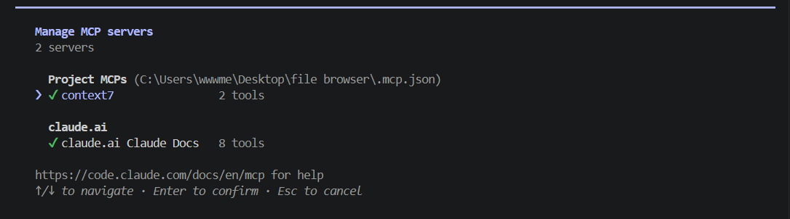
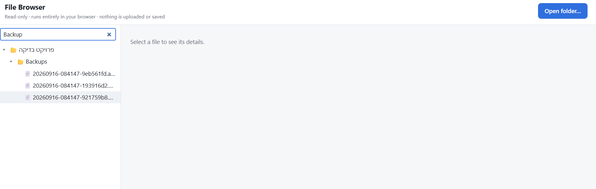
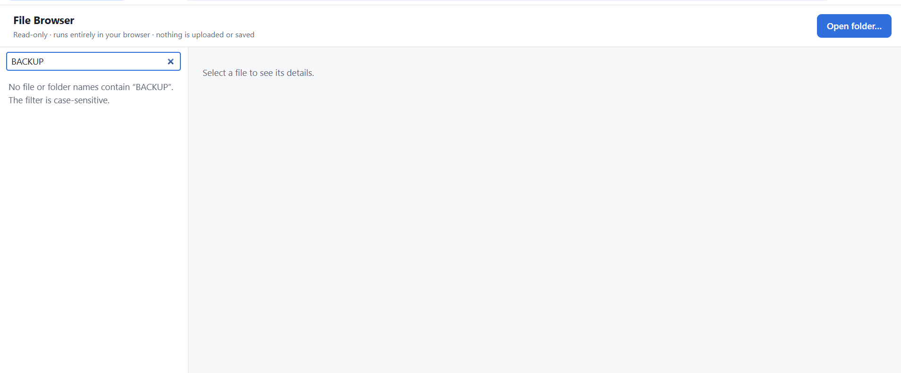
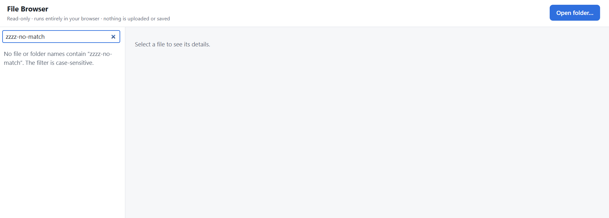
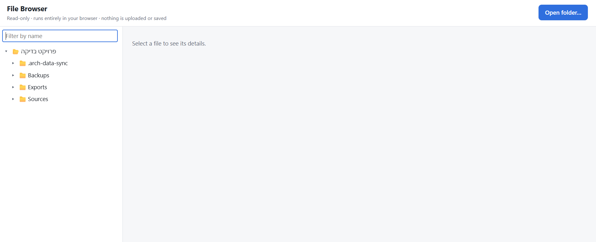
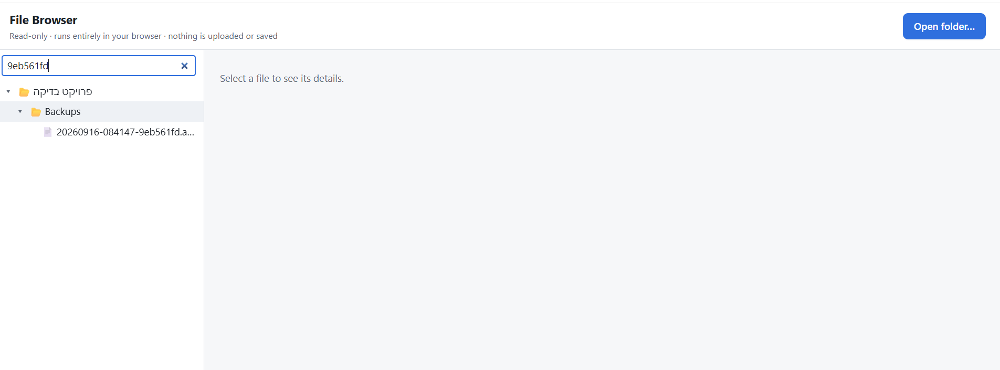
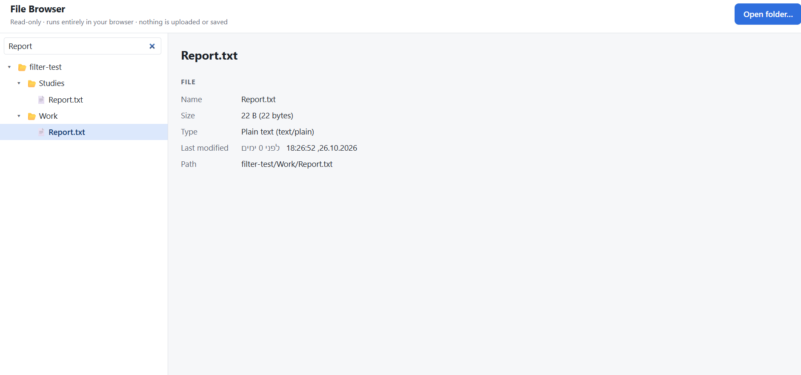
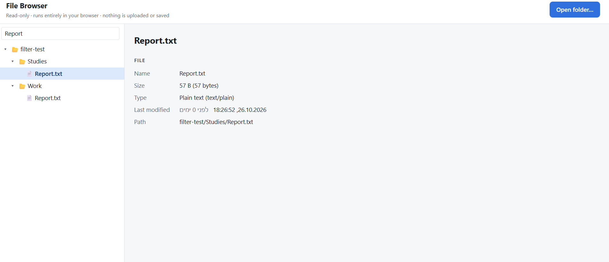

<div dir="rtl">

# משימה 10 — Context7 וסינון העץ

## חיבור ברמת הפרויקט

נוסף שרת Context7 בקובץ `.mcp.json` בשורש הפרויקט. הקובץ נקרא ונבדק: הוא מכיל כתובת שרת בלבד, ללא מפתח, סיסמה או כותרת אימות.

</div>

```json
{
  "mcpServers": {
    "context7": {
      "type": "http",
      "url": "https://mcp.context7.com/mcp"
    }
  }
}
```

<div dir="rtl">

ב־`/mcp` נראה Context7 עם סימון ירוק ושני כלים, תחת Project MCPs.



## שימוש בפועל בתיעוד

**בקשת המשתמש — סיכום:** להוסיף סינון מעמיק לפי שמות, להיעזר ב־Context7 לשליפת תיעוד React לפני המימוש, ולמנוע מתוצאות חיפוש ישנות לעדכן את התצוגה. בהמשך התבקש גם סינון לפי שמות תיקיות והצגת כל תוכנה של תיקייה מתאימה.

**פעולת הסוכן:** ביומן השיחה המקורי נמצאו קריאת זיהוי ספריית React ושתי קריאות שליפת תיעוד. נשמר [תמליל כלי ממוקד](evidence/context7-tool-calls.json), הכולל את שמות הכלים, הבקשות והתוצאות המקוריות בלבד, ללא שאר השיחה.

</div>

```text
mcp__context7__resolve-library-id
libraryName: React

mcp__context7__query-docs
libraryId: /websites/react_dev
query: useEffect data fetching with cleanup ignore flag to avoid race conditions and stale results

mcp__context7__query-docs
libraryId: /websites/react_dev
query: controlled text input with value and onChange state
```

<div dir="rtl">

**תשובת הסוכן — סיכום:** התיעוד שימש לחיבור שדה נשלט באמצעות `value` ו־`onChange`, ולניקוי חיפוש קודם כשמשתנים הטקסט או התיקייה. הסוכן דיווח על שימוש בדגל ביטול וב־`AbortController` לסריקה המקומית. שליפת התיעוד נעשתה בזמן הפיתוח; היא אינה חלק מפעולת האפליקציה בזמן השימוש.

## הפיצ׳ר והבדיקות

נוסף שדה מעל העץ. הסינון מבחין בין אותיות גדולות לקטנות, מחפש בכל תיקיות המשנה לפי שמות קבצים ותיקיות, ומשמר נתיבים נפרדים לקבצים בעלי שם זהה. תיקייה מתאימה מוצגת עם כל תוכנה. ריקון השדה מחזיר את העץ הרגיל.

**בדיקות אוטומטיות:** `npm run check` הורץ על הגרסה הסופית, לפני ה־commit, ועבר: typecheck, lint ו־62 מתוך 62 בדיקות. הבדיקות האוטומטיות מכסות את לוגיקת החיפוש; הן אינן בדיקות ממשק. הבנייה עברה לפני הרחבת הסינון לתיקיות, ולא דווחה הרצת בנייה נוספת לאחר ההרחבה.

**בדיקות ידניות שנצפו בצילומי המשתמש:**

- חיפוש `Backup` מציג את `Backups` ואת תוכנה. בחירה בקובץ מתוך תוצאות הסינון והצגת פרטיו הודגמו בצילומי `Report.txt`.
- `BACKUP` אינו מוצא התאמות, בניגוד ל־`Backup`, במקרה שנבדק.
- חיפוש ללא התאמות מציג הודעה ברורה; ריקון השדה מחזיר את העץ.
- חיפוש `9eb561fd` מציג קובץ פנימי עם מסלול התיקיות אליו. לפי מהלך הבדיקה, התיקייה הייתה סגורה לפני החיפוש; הצילום מתעד את התוצאה.
- חיפוש `Report` מציג שני קבצים בשם `Report.txt`. בחירת כל אחד מציגה נתיב וגודל שונים: Work — ‏22 בתים; Studies — ‏57 בתים.









לא נבדקו ידנית: ביטול תוצאות ישנות בזמן סריקה ממושכת, כשלי הרשאות, ביצועים בתיקייה גדולה, תיקייה ריקה מתאימה, דפדפן חלופי ובדיקת רשת ואחסון בכלי המפתחים. אין להציגם כבדיקות שעברו.

## מצב תנאי הסיום

- קובץ חיבור ללא סודות: תוכנו אומת לפני ה־commit, והוא נכלל בו.
- חיבור ב־`/mcp`: הודגם בצילום.
- קריאת Context7 לשליפת תיעוד בזמן המימוש: אומתה ביומן המקורי ונשמרה כראיה.
- פעולת הפיצ׳ר: הודגמה במקרים הידניים שלעיל; `npm run check` הורץ על הגרסה הסופית ועבר.
- שמירת הפיצ׳ר והתיעוד: מסמך זה נכלל ב־commit אחד יחד עם חיבור Context7, הפיצ׳ר והבדיקות שלו, לצורך העלאה ל־`main` ב־origin. מזהה ה־commit אינו רשום כאן, כי הוא נקבע רק ביצירת ה־commit; הוא מופיע בהיסטוריית Git.

</div>
