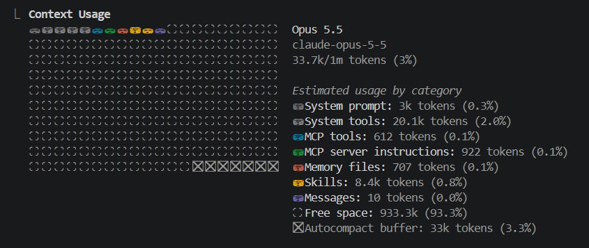
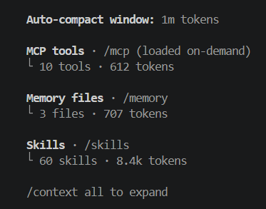
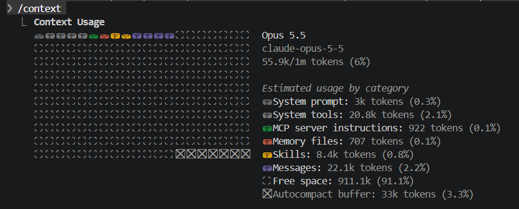

# משימה 11 — ניתוח זרימת החיפוש בסוכן משנה מסוג Explore

## בקשת המשתמש

> העבר לסוכן משנה מסוג Explore משימת קריאה בלבד: בדוק כיצד החיפוש בעץ עובר משדה הקלט לסריקת התיקיות ולהצגת התוצאות, וכיצד נמנעים עדכונים מתוצאות חיפוש ישנות.
>
> בקש ממנו להחזיר סיכום של עד 8 נקודות, עם הפניות לקבצים ולשורות. אל תשנה קבצים ואל תריץ בדיקות. בשיחה הראשית אל תקרא בעצמך את קובצי המימוש; הצג את סיכום סוכן המשנה.

## הפעלת הסוכן

הסוכן הראשי הפעיל סוכן Explore בשם "Trace tree search flow", במשימת קריאה בלבד. הוא לא קרא בעצמו את קובצי המימוש. הנוסח המלא של ההפעלה ושל התשובה נמצא ב[קטע התמליל](evidence/explore-transcript.txt).

## תשובת סוכן המשנה — סיכום

זה סיכום מקוצר ולא ציטוט.

1. **קלט:** שדה החיפוש נמצא ב-`src/App.tsx:43-51`. כל הקשה קוראת ל-`setQuery` (שורה 49).
2. **מעבר בין תצוגות:** כשהשדה לא ריק, מוצג `FilterResults` במקום `TreeView` (`src/App.tsx:53-62`).
3. **הפעלת הסריקה:** `useEffect` שתלוי ב-`[root, query]` קורא ל-`searchTree` עם `AbortSignal` (`src/components/FilterResults.tsx:24-41`).
4. **הסריקה:** `searchTree` ו-`searchDirectory` עוברים על העץ ברקורסיה ובמקביל (`src/lib/search.ts:44-84`).
5. **הצגה:** העץ התואם מוצג דרך `MatchDirectoryNode`, יחד עם הודעות על חיפוש פעיל, שגיאה, חיפוש חלקי או היעדר התאמות (`src/components/FilterResults.tsx:43-145`).
6. **הגנה מפני תוצאות ישנות:** פונקציית הניקוי של ה-effect מסמנת `cancelled = true` וקוראת ל-`controller.abort()` (`src/components/FilterResults.tsx:37-40`). הדגל מונע עדכון מחיפוש ישן, וה-signal עוצר את הסריקה מוקדם.
7. **פערים:** אין השהיה בין הקשות (debounce), וה-signal לא מועבר ל-`listChildren()` (`src/lib/search.ts:64`). לפי הסוכן, אף אחד מהם לא גורם לתוצאה ישנה להגיע למסך.

## מדידות `/context`

- **לפני:** 33.7k טוקנים בסך הכול. Messages: ‏10 טוקנים.
- **אחרי:** 55.9k טוקנים בסך הכול. Messages: ‏22.1k טוקנים.
- **העלייה הכוללת:** כ-22.2k טוקנים.

המדידות מתייחסות להקשר השיחה הראשית; לא נמדד חיסכון לעומת קריאה ישירה.

## מתי כדאי להפריד

**ההפרדה מועילה** בניתוח ממוקד שמחייב קריאה של כמה קבצים, כמו מעקב אחרי זרימה מהממשק דרך הלוגיקה ובחזרה לממשק. סוכן המשנה קורא את הקבצים, והשיחה הראשית מקבלת סיכום עם הפניות.

**ההפרדה מיותרת** בשאלה פשוטה, למשל מה עושה שורה אחת.

