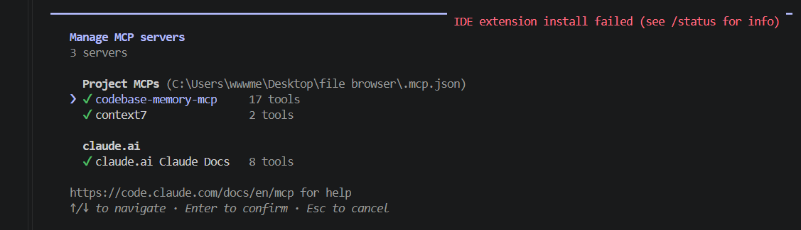

<div dir="rtl">

# משימה 12 — codebase-memory-mcp וגרף הקוד

## הגדרת החיבור

השרת codebase-memory-mcp, גרסה 0.12.1, הותקן דרך npm. בקובץ `.mcp.json` בשורש הפרויקט הוא מוגדר כשרת stdio, ש־Claude Code מפעיל באמצעות `cmd /c` ושם הפקודה. ההגדרה לא כוללת נתיב אישי.

</div>

```json
"codebase-memory-mcp": {
  "type": "stdio",
  "command": "cmd",
  "args": ["/c", "codebase-memory-mcp"]
}
```

<div dir="rtl">

## ראיית החיבור

ב־`/mcp` השרת codebase-memory-mcp מופיע תחת Project MCPs עם סימון ירוק ו־17 כלים.



## בדיקת הגדרה כפולה

נבדק שאין הגדרת משתמש כפולה לשרת; החיבור מוגדר ברמת הפרויקט בלבד, ולכן לא נדרשה הסרה.

## השאלה לגרף

**בקשת המשתמש (ציטוט):** „מי קורא לפונקציה searchTree?”

**תשובת הסוכן (סיכום):**

- האינדוקס הגיע למצב `ready`, עם 537 צמתים ו־1187 קשרים.
- הכלי `trace_path`, שהורץ עם כיוון `inbound` וכולל בדיקות, החזיר שני קוראים:
  - `FilterResults`, מקוד האפליקציה.
  - `search.test.ts`, מהבדיקות. הגרף מייצג את הבדיקות ברמת הקובץ, ולא כבדיקות בודדות.

הקריאות והתוצאות המקוריות נשמרו ב[תמליל הגרף](evidence/graph-transcript.txt).

</div>
