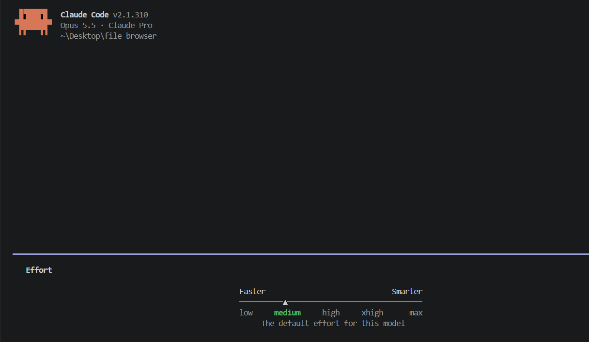

# משימה 3: ספירת עמודים בקובצי PDF

## בחירת effort

לפני הרצת הפרומפט נבחרה רמת effort ‏`medium` בפקודה `/effort`, והיא נשמרה כברירת המחדל. הפרומפט נשלח אחרי הבחירה.



## הפרומפט

הפרומפט נשלח בתחילת השיחה. הוא מועתק כאן מילה במילה, בלי תיקונים:

```text
<data_first>
<context>
האפליקציה הקיימת היא File Browser בדפדפן, המבוססת על React ו־TypeScript. המשתמש בוחר תיקייה ורואה עץ קבצים וחלונית פרטים בהתאם לקובץ שנבחר. כבר קיים גם זמן יחסי לצד תאריך השינוי האחרון.

כללי הפרויקט:
- עיבוד הקבצים מקומי בלבד, ללא שרת, קריאות רשת, שמירה מתמשכת או כתיבה לקבצים.
- אין שימוש ב־localStorage או IndexedDB.
- הקוד ב־src/lib/ אינו מייבא React.
- העיצוב משתמש במשתני CSS מקובץ ה־tokens הקיים.
</context>
</data_first>

<role>
פעל כמפתח Frontend שמכיר React, TypeScript ועיבוד קובצי PDF בדפדפן.
</role>

<brief_once>
<be_specific>
<task>
הוסף ספירת עמודים בקובצי PDF בחלונית הפרטים של הקובץ הנבחר.

רק כאשר נבחר PDF, הצג שדה בשם Pages עם מספר העמודים, בפורמט Pages: N.

אם אי אפשר לקרוא את מספר העמודים, הצג:
Unable to read the page count for this PDF.

שאר פרטי הקובץ יישארו מוצגים והאפליקציה תמשיך לעבוד.
</task>
</be_specific>

<constraints>
הוסף רק את הפיצ׳ר הזה. שמור על התנהגות האפליקציה והפיצ׳רים הקיימים, כולל הזמן היחסי. אל תשנה הגדרות Claude Code ואל תפעיל תהליכי BMAD.
</constraints>

<done_when>
- ספירת העמודים מוצגת נכון בקובצי PDF.
- בקובץ שאינו PDF לא מוצג שדה Pages.
- כשל בקריאת PDF מציג את ההודעה שהוגדרה, בלי לפגוע בשאר הפרטים.
- נוספו בדיקות רלוונטיות ו־npm run check עוברת.
- הפיצ׳ר נבדק בממשק. אם אינך יכול לבצע בדיקה זו בעצמך, דווח מה נותר לי לבדוק.
</done_when>

<output>
בסיום הצג סיכום קצר של השינוי, הקבצים ששונו, תוצאות הבדיקות ומה נותר לבדיקה ידנית. אל תבצע commit עדיין.
</output>
</brief_once>

<multishot>
<examples>
- PDF עם עמוד אחד → Pages: 1.
- PDF עם 12 עמודים → Pages: 12.
- קובץ שאינו PDF → שדה Pages לא יוצג.
- PDF שלא ניתן לקרוא את מספר עמודיו → Unable to read the page count for this PDF.
</examples>
</multishot>
```

## מיפוי שבע הטכניקות

| טכניקה | איפה היא מופיעה |
|---|---|
| Data first | הבלוק `<data_first>` בא ראשון. בתוכו `<context>` מתאר את האפליקציה הקיימת ואת כללי הפרויקט, לפני כל הוראה. |
| Give a role | הבלוק `<role>`: "פעל כמפתח Frontend שמכיר React, TypeScript ועיבוד קובצי PDF בדפדפן." |
| Be specific | הבלוק `<be_specific>` עם `<task>`: שם השדה (Pages), הפורמט (Pages: N), התנאי (רק כשנבחר PDF) וטקסט השגיאה המדויק. |
| Brief once | הבלוק `<brief_once>` מרכז את כל התדריך בהודעה אחת: המשימה, הגבולות (`<constraints>`), תנאי הסיום (`<done_when>`) ופורמט הדיווח (`<output>`). כך לא היה צריך להשלים הוראות בהמשך השיחה. |
| Multishot | הבלוק `<multishot>` עם `<examples>`: ארבע דוגמאות של קלט ותוצאה צפויה (עמוד אחד, 12 עמודים, קובץ שאינו PDF, PDF שלא ניתן לקריאה). |
| XML structure | כל הפרומפט בנוי מתגיות XML שמפרידות בין החלקים: `<context>`, `<role>`, `<task>`, `<constraints>`, `<done_when>`, `<output>`, `<examples>`. |
| Dial effort | לא מופיעה בטקסט הפרומפט. רמת ה־effort נקבעה ל־`medium` בפקודה `/effort` לפני ששלחתי אותו (ראו "בחירת effort" למעלה). |

## המימוש

- כשנבחר PDF, נוספת לחלק File שורה בשם Pages. התווית מוצגת בעמודה אחת והמספר בעמודה השנייה, כמו בשאר השורות.
- בזמן הקריאה מוצג `Reading…`. אם הקריאה נכשלת מוצג `Unable to read the page count for this PDF.`, ושאר הפרטים, כולל הזמן היחסי, נשארים במקומם.
- בקובץ שאינו PDF השורה לא מוצגת. קובץ נחשב PDF לפי סוג ה־MIME ‏(`application/pdf`) או לפי הסיומת `.pdf`.
- הקריאה נעשית כולה בדפדפן, בלי ספרייה חיצונית ובלי worker. כך לא נוספה תלות ולא נדרש שינוי ב־Content Security Policy. הקוד הולך מהקטלוג של הקובץ לעץ העמודים וקורא ממנו את `/Count`. הוא מטפל גם ב־object streams דחוסים (נפוצים ב־PDF 1.5 ומעלה) ובקבצים שנערכו כמה פעמים, ואז נלקחת הגרסה האחרונה.
- מגבלה: הקובץ כולו נקרא לזיכרון, ולכן ב־PDF גדול מאוד יכולה להיות השהיה קצרה עד שהמספר מופיע.

| קובץ | שינוי |
|---|---|
| `src/lib/pdf.ts` | חדש. `isPdf` ו־`readPdfPageCount`. לא מייבא React. |
| `src/lib/pdf.test.ts` | חדש. 10 בדיקות. |
| `src/components/DetailsPanel.tsx` | שורת Pages ו־hook קטן לקריאת מספר העמודים. |

## בדיקות

### `npm run check`

הבדיקה הורצה בסוף המימוש, וכל השלבים עברו:

- typecheck: עבר
- lint: עבר
- test: ‏44 בדיקות עברו, ב־4 קובצי בדיקה. 10 מהן חדשות, ב־`src/lib/pdf.test.ts`.

הבדיקות החדשות מכסות PDF עם עמוד אחד (1), עם 12 עמודים (12), object stream דחוס, קובץ שנערך כמה פעמים, ערך `/Count` שמופנה מאובייקט אחר וזיהוי PDF לפי סוג או סיומת. הן בודקות גם שבקובץ שאינו PDF, ב־PDF קטוע, ב־`/Count` לא תקין ובזרם דחוס פגום מוחזר `null`, ואז מוצגת הודעת השגיאה.

### `npm run build`

הבנייה עברה בהצלחה.

### בדיקה ידנית בממשק

לפי בדיקת המשתמש בממשק, בתאריך 25.10.2026, ארבעת המקרים הצליחו:

| מקרה | תוצאה | צילום |
|---|---|---|
| `one-page.pdf` | Pages: ‏1 | [`02-one-page-pdf.png`](evidence/02-one-page-pdf.png) |
| `three-pages.pdf` | Pages: ‏3 | [`03-three-pages-pdf.png`](evidence/03-three-pages-pdf.png) |
| קובץ שאינו PDF ‏(`.gitignore`) | לא הוצגה שורת Pages | [`04-non-pdf-file.png`](evidence/04-non-pdf-file.png) |
| `invalid-test.pdf` | `Unable to read the page count for this PDF.` ושאר פרטי הקובץ והזמן היחסי נשארו מוצגים | [`05-invalid-pdf.png`](evidence/05-invalid-pdf.png) |

**פרטיות:** בדקתי את הצילומים לפני שהעתקתי אותם לפרויקט. מצילומי הממשק חתכתי את סרגל הלשוניות של הדפדפן (כותרות של אתרים אחרים), את שורת הכתובת עם תמונת הפרופיל ואת שורת המשימות של Windows. הצילומים נשמרו מחדש בלי מטא־דאטה מוטמע. בצילום בחירת ה־effort מופיעים גרסת Claude Code, הדגם, סוג המנוי והנתיב `~\Desktop\file browser`. קובצי ה־PDF ששימשו לבדיקה לא נכללו בפרויקט.
