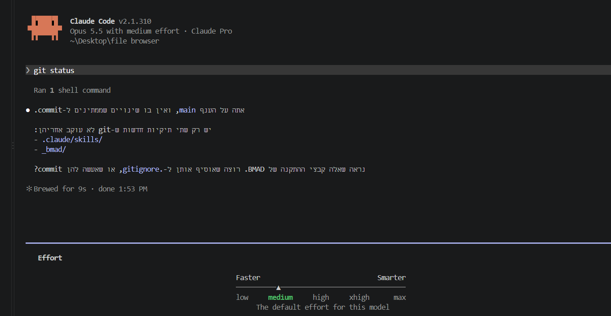

# משימה 4: תג Large file בתצוגת העץ

## בחירת effort

לפני הרצת הפרומפט נבחרה רמת effort ‏`medium` בפקודה `/effort`, והיא נשמרה כברירת המחדל. הפרומפט נשלח אחרי הבחירה.



## הפרומפט

הפרומפט מועתק כאן מילה במילה, כולל הרווחים הכפולים והשגיאות:

```text
אני רוצה שתוסיף לי פיצ'ר חדש שבתצוגת העץ  יופיע האם זהו קובץ גדול מ-10MB,אם זהו קובץ גדול יופיע Large file  אחרת לא יופיע כלום המטרה היא כדי לראות באופן מהיר האם זהו קובץ גדול מעל מ-10MB. אני רוצה גם שתשתמש במתשני css מקובץ הtokens  הקיים בכדי לשמור על אחידות העיצוב.
אני רוצה שרק תוסיף לי את הפיצ'ר הנ"ל מבלי לשנות משהו שלא קשור לפיצ'ר ומבלי לתקן באגים שלא קשורים לפיצ'ר(אלא רק תדווח עליהם אם מצאת כאלה או תציין שלא מצאת במידה ולא מצאת) ותנאי הסיום הוא כאשר הפיצ'ר עומד בדרישות הנ"ל והבדיקה npm run check עוברת בהצלחה
```

## איך הפרומפט מיישם את הנחיות שקופית 9

| הנחיה | איפה היא מופיעה בפרומפט |
|---|---|
| מטרה ותנאי סיום | המטרה: "המטרה היא כדי לראות באופן מהיר האם זהו קובץ גדול מעל מ-10MB". תנאי הסיום: "ותנאי הסיום הוא כאשר הפיצ'ר עומד בדרישות הנ"ל והבדיקה npm run check עוברת בהצלחה". |
| גבולות ברורים | "שרק תוסיף לי את הפיצ'ר הנ"ל מבלי לשנות משהו שלא קשור לפיצ'ר ומבלי לתקן באגים שלא קשורים לפיצ'ר". גם ההתנהגות עצמה מוגדרת בשני הכיוונים: "יופיע Large file" ו"אחרת לא יופיע כלום". |
| בדיקה שאפשר להריץ | `npm run check`, פקודה אחת שמריצה typecheck, ‏lint ובדיקות יחידה, והיא חלק מתנאי הסיום. |
| כלל עם סיבה | הכלל: "שתשתמש במתשני css מקובץ הtokens הקיים". הסיבה: "בכדי לשמור על אחידות העיצוב". |
| דיווח על באגים אחרים בלי לתקנם | "(אלא רק תדווח עליהם אם מצאת כאלה או תציין שלא מצאת במידה ולא מצאת)". |

## המימוש

- **הסף:** ‏10 × 1024² = ‏10,485,760 בתים. אלה היחידות הבינאריות שבהן הפרויקט כבר משתמש להצגת גדלים (`formatBytes`, שבה 1 MB = ‏1024 KB).
- **מתי מופיע התג:** רק כשהקובץ גדול מהסף (`size > LARGE_FILE_BYTES`). קובץ בגודל הסף בדיוק לא מקבל תג.
- **בתצוגת העץ:** כל שורת קובץ קוראת את גודל הקובץ, ואם הוא מעל הסף מוצג התג `Large file` בקצה השורה. כשהקובץ קטן יותר לא מוצג כלום. אם אי אפשר לקרוא את הקובץ, גם אז לא מוצג תג.
- **עיצוב:** המחלקה `.tree-badge` משתמשת רק במשתנים שכבר קיימים ב־`src/styles/tokens.css`. לא נוספו משתנים חדשים, והתג מותאם גם למצב כהה דרך אותם משתנים.

| קובץ | שינוי |
|---|---|
| `src/lib/fileInfo.ts` | הקבוע `LARGE_FILE_BYTES` והפונקציה `isLargeFile`. |
| `src/lib/fileInfo.test.ts` | בדיקות לגבולות הסף: 0, בדיוק 10 MB, בית אחד מעל, ‏2 GB. |
| `src/components/TreeView.tsx` | קריאת הגודל בכל שורת קובץ והצגת התג. |
| `src/styles/app.css` | המחלקה `.tree-badge`. |

## בדיקות

### `npm run check`

לפי הדיווח של Claude Code, הבדיקה עברה:

- typecheck: עבר
- lint: עבר
- test: ‏48 בדיקות עברו, ב־4 קובצי בדיקה. ארבע מהן חדשות, ב־`src/lib/fileInfo.test.ts`.

### בדיקה ידנית בממשק

בדקתי בממשק את שלושת מקרי הגבול, ב־25.10.2026, וכולם עברו:

| קובץ | גודל | תוצאה | צילום |
|---|---|---|---|
| `below-threshold.bin` | ‏10,485,759 בתים | ללא תג | [`02-below-threshold.png`](evidence/02-below-threshold.png) |
| `exact-threshold.bin` | ‏10,485,760 בתים | ללא תג | [`03-exact-threshold.png`](evidence/03-exact-threshold.png) |
| `above-threshold.bin` | ‏10,485,761 בתים | מופיע `Large file` | [`04-above-threshold.png`](evidence/04-above-threshold.png) |

קובצי הבדיקה הגדולים לא נכללו בפרויקט.

## באגים אחרים

Claude Code דיווח שלא מצא באגים אחרים בקוד שקרא במהלך העבודה: `TreeView.tsx`, ‏`fileInfo.ts`, ‏`entries.ts`, ‏`tokens.css` ורוב `app.css`. הוא גם ציין שלא בדק את שאר הקבצים בפרויקט, ולכן זו לא בדיקה של כל הפרויקט.

**פרטיות:** בדקתי את הצילומים לפני שהעתקתי אותם לפרויקט. מצילומי הממשק חתכתי את השטח הריק ואת הכפתור Open folder. מצילום ה־effort חתכתי את שורת העזרה הקטועה שבתחתית. הצילומים נשמרו מחדש בלי מטא־דאטה מוטמע. בצילום בחירת ה־effort מופיעים גרסת Claude Code, הדגם, סוג המנוי והנתיב `~\Desktop\file browser`.
