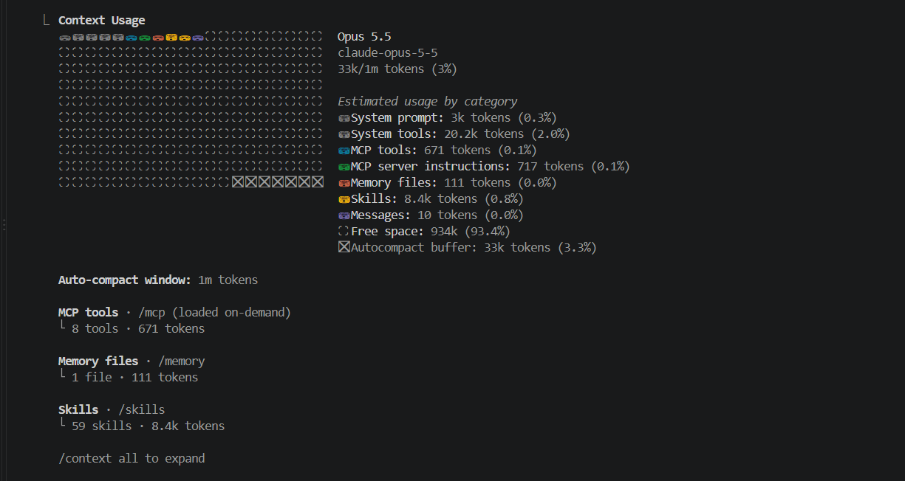
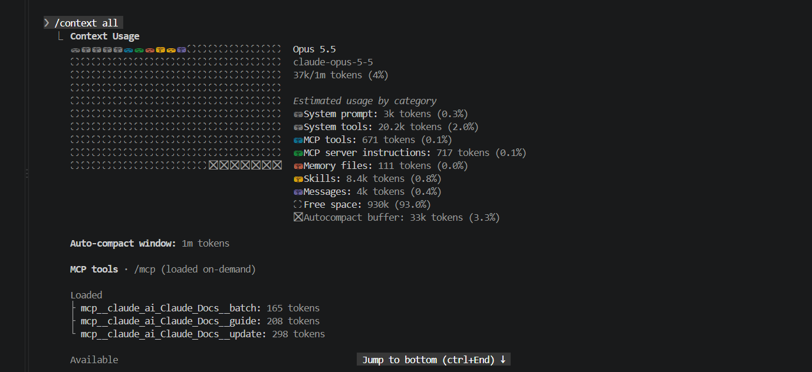
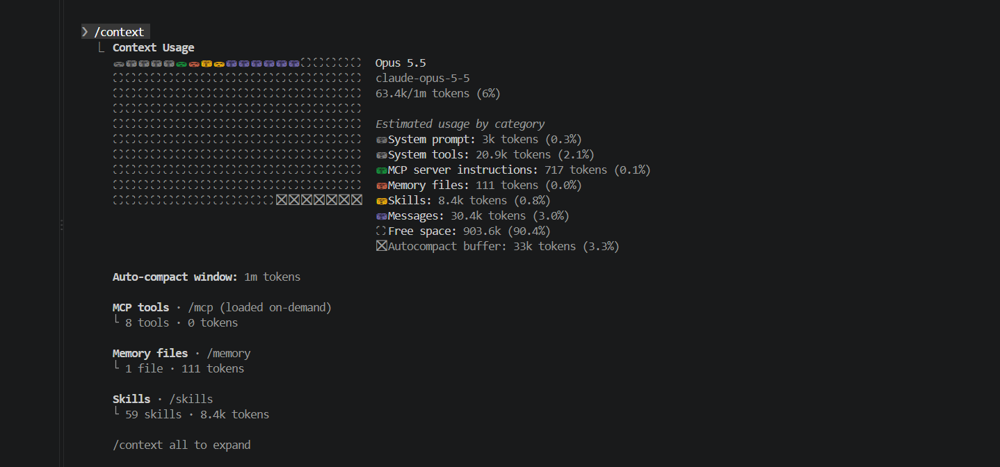

# משימה 5: חלון הקונטקסט ומקורותיו

## מה נבדק

בדקתי בפקודה `/context` מה תופס את חלון הקונטקסט בתחילת שיחה חדשה, ואיך הוא משתנה אחרי הודעה רגילה שעובדת על הפרויקט. הדגם בכל המדידות הוא Opus 5.5 ‏(`claude-opus-5-5`), עם חלון של מיליון טוקנים.

המדידות:

1. **מדידה ראשונית** בשיחה חדשה, ב־`/context`.
2. **מדידת `/context all`** מיד אחריה. זו נקודת ההשוואה להודעה הרגילה.
3. **הודעה רגילה:** בקשה לקרוא רק את `src/lib/fileInfo.ts` ואת `src/components/TreeView.tsx` ולהסביר את `isLargeFile` ואת השימוש בה, בלי לשנות דבר.
4. **מדידה אחרי הקריאה והתשובה**, ב־`/context`.

## המדידה הראשונית

סך הכול כ־33,000 טוקנים, ‏3% מהחלון.

| קטגוריה | טוקנים | מקור |
|---|---|---|
| System prompt | כ־3,000 | הוראות המערכת של Claude Code. |
| System tools | כ־20,200 | הגדרות הכלים המובנים של Claude Code (קריאה, עריכה, חיפוש, הרצת פקודות ועוד). |
| MCP tools | ‏671 | הכלים של חיבור Claude Docs ‏(`claude_ai_Claude_Docs`). |
| MCP server instructions | ‏717 | ההוראות שחיבור Claude Docs מוסיף לשיחה. |
| Memory files | ‏111 | הקובץ `MEMORY.md` של הפרויקט, בתיקיית הזיכרון האישית תחת `~\.claude\projects\`. |
| Skills | כ־8,400 | תיאורים קצרים של 59 Skills: ‏Skills של BMAD בפרויקט, Skills מסונכרנים מ־claude.ai ו־Skills מובנים של Claude Code. |
| Messages | ‏10 | היסטוריית השיחה. בשלב הזה כמעט ריקה. |

שתי שורות נוספות בפלט אינן תוכן שנטען:

- **Free space** (כ־934,000): מקום פנוי בחלון.
- **Autocompact buffer** (כ־33,000): מקום שמור לדחיסה אוטומטית של השיחה כשהיא מתארכת.

בשלב הזה **System tools** היא הקטגוריה הגדולה ביותר.

## נקודת ההשוואה: `/context all`

במדידה הזו הסכום עלה ל־כ־37,000 טוקנים, ו־Messages כבר הייתה כ־4,000 טוקנים. שאר הקטגוריות לא השתנו.

הגידול מ־10 ל־4,000 קרה **לפני** ההודעה הרגילה. סיבתו המדויקת לא אומתה.

מכיוון שהמדידה הזו קרובה ביותר להודעה הרגילה, היא נקודת ההשוואה בהמשך.

בצילום מופיע גם פירוט של כלי ה־MCP: שלושה כלים מסומנים כ־Loaded‏ (`batch` ‏165, ‏`guide` ‏208, ‏`update` ‏298). הסכום שלהם הוא 671, בדיוק כמו בשורה MCP tools. שאר הכלים מופיעים תחת Available. הצילום נחתך בכותרת Available, ולכן הוא לא מראה את המשך הפירוט.

## המדידה אחרי ההודעה הרגילה

סך הכול כ־63,400 טוקנים, ‏6% מהחלון.

## השוואה לפני ואחרי

| קטגוריה | לפני (`/context all`) | אחרי | שינוי |
|---|---|---|---|
| System prompt | כ־3,000 | כ־3,000 | ללא שינוי |
| System tools | כ־20,200 | כ־20,900 | כ־‎+700 |
| MCP tools | ‏671 | ‏0 | ‎−671 |
| MCP server instructions | ‏717 | ‏717 | ללא שינוי |
| Memory files | ‏111 | ‏111 | ללא שינוי |
| Skills | כ־8,400 | כ־8,400 | ללא שינוי |
| Messages | כ־4,000 | כ־30,400 | כ־‎+26,400 |
| **סך הכול** | כ־37,000 | כ־63,400 | כ־‎+26,400 |

## ממצאים

- **הקטגוריה הגדולה ביותר התחלפה.** בתחילה זו הייתה System tools‏ (כ־20,200). אחרי ההודעה זו Messages‏ (כ־30,400).
- **Messages גדלה בכ־26,400 טוקנים** ביחס לנקודת ההשוואה. היסטוריית השיחה כוללת את הבקשות, את קריאות הכלים, את פלטי הקריאה של הקבצים ואת התשובות. אין בפלט פירוט שמאפשר לייחס במדויק את כל הגידול לשני הקבצים שנקראו.
- **שאר הקטגוריות כמעט קבועות.** הוראות המערכת, הזיכרון ותיאורי ה־Skills נטענים פעם אחת בתחילת השיחה ולא גדלים מהעבודה עצמה.
- **System tools עלתה בכ־700, ו־MCP tools ירדה ל־0.** לא בדקתי מה גרם לשני השינויים האלה.

## פערים בין הנתונים לצילומים

- **MCP tools במדידה האחרונה:** בצילום אין שורה MCP tools ברשימת הקטגוריות בכלל. הערך 0 נלקח מהפירוט בתחתית: "8 tools · 0 tokens".
- **הצילום של `/context all`** נחתך בכותרת Available, ולכן הוא לא מראה את רשימת הכלים הזמינים ואת פירוט ה־Skills.

שאר הנתונים בתיעוד תואמים לצילומים.

## הצעה לצמצום

אפשר לצמצם זמנית את תיאורי ה־Skills של BMAD בזמן תרגיל 1, כי לא משתמשים ב־BMAD בשלב הזה. הם 29 מתוך 59 ה־Skills שנטענים לכל שיחה.

**זו הצעה בלבד.** לא בוצע שום שינוי, ונצטרך את ה־Skills האלה בתרגיל 2.

## פרטיות

בדקתי את שלושת הצילומים לפני שהעתקתי אותם לפרויקט. מופיעים בהם רק נתוני `/context`, שם הדגם ושמות כלי ה־MCP. אין בהם שם משתמש, כתובת מייל או נתיבים. לא היה בקבצים מטא־דאטה מוטמע, והם הועתקו כמו שהם.
