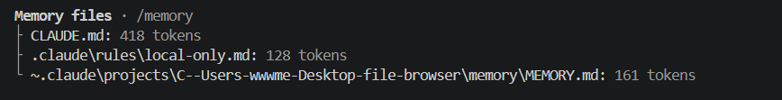
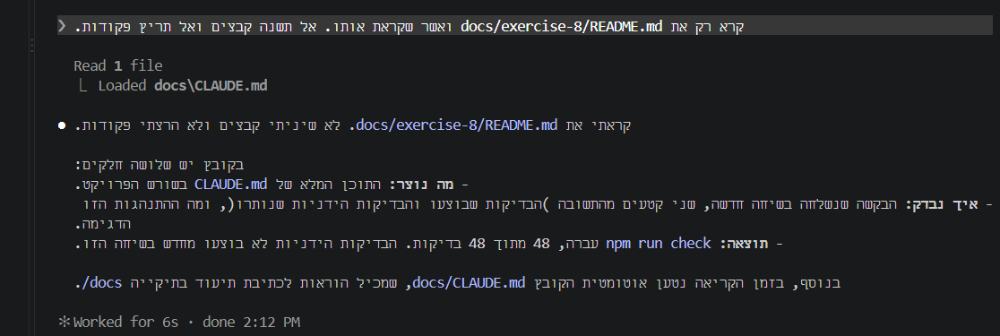
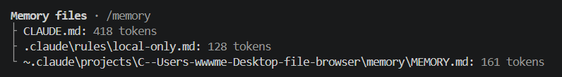

<div dir="rtl">

# משימה 9 — CLAUDE.md בתיקיית docs

## מה נוצר

נוצר הקובץ [`docs/CLAUDE.md`](../CLAUDE.md), עם הוראות לכתיבת תיעוד שחלות רק על `docs/` ותיקיות המשנה שלה. המטרה היא ש־Claude יטען את ההוראות האלה רק כשהוא עובד על קבצים בתיקייה הזו, ולא בכל שיחה. הקובץ נשמר ב־commit ‏`160528a` ("Add docs/CLAUDE.md with documentation instructions"). זה אומת עם `git log`, ו־`git status` לא הראה בו שינויים שלא נשמרו.

זה התוכן המלא שלו:

</div>

```markdown
# Documentation

These instructions apply to `docs/` and its subfolders.

## Content

- Keep each document short: what was done, how it was checked, and what the result was.
- When documenting a conversation, keep the user's request and Claude's response clearly separate, for example under their own headings.
- Quotes must match the source exactly, so readers can trust them. Mark any shortened or paraphrased text as a summary, not a quote. If the source is not available, ask for it instead of writing a quote.

## Direction (GitHub Markdown)

- Wrap Hebrew text in `<div dir="rtl">` … `</div>`, with a blank line after the opening tag and before the closing tag, so GitHub still renders the Markdown inside.
- Put commands, code, paths and English blocks in fenced code blocks outside the RTL `div`: close the `div` before the block and reopen it after, so they display left to right.
- Short inline code such as `npm run check` can stay inside Hebrew sentences.
```

<div dir="rtl">

## איך נבדק

הבדיקה נעשתה בשיחה חדשה.

### לפני הקריאה

בפלט של `/context all`, הרשימה Memory files כללה שלושה קבצים בלבד: `CLAUDE.md` (418), `.claude\rules\local-only.md` (128) ו־`MEMORY.md` (161). סך הכול 707 טוקנים. הקובץ `docs/CLAUDE.md` לא הופיע ברשימה.



### הבקשה שנשלחה

> קרא רק את docs/exercise-8/README.md ואשר שקראת אותו. אל תשנה קבצים ואל תריץ פקודות.

### מה הוצג בזמן הקריאה

Claude קרא קובץ אחד, ומתחת לקריאה הופיעה הודעת טעינה:

</div>

```text
Read 1 file
⎿ Loaded docs\CLAUDE.md
```

<div dir="rtl">



### התשובה שהתקבלה

התשובה המלאה:

> קראתי את `docs/exercise-8/README.md`. לא שיניתי קבצים ולא הרצתי פקודות.
>
> בקובץ יש שלושה חלקים:
> - **מה נוצר:** התוכן המלא של `CLAUDE.md` בשורש הפרויקט.
> - **איך נבדק:** הבקשה שנשלחה בשיחה חדשה, שני קטעים מהתשובה (הבדיקות שבוצעו והבדיקות הידניות שנותרו), ומה ההתנהגות הזו הדגימה.
> - **תוצאה:** `npm run check` עברה, 48 מתוך 48 בדיקות. הבדיקות הידניות לא בוצעו מחדש בשיחה הזו.
>
> בנוסף, בזמן הקריאה נטען אוטומטית הקובץ `docs/CLAUDE.md`, שמכיל הוראות לכתיבת תיעוד בתיקייה `docs/`.

### אחרי הקריאה

הרצה נוספת של `/context all` החזירה את אותה רשימת Memory files, עם אותם שלושה קבצים ואותו סכום של 707 טוקנים. `docs/CLAUDE.md` עדיין לא הופיע ברשימה.



## תוצאה

- **הודגם:** הטעינה לפי הצורך. `docs/CLAUDE.md` לא נטען בתחילת השיחה. הוא נטען רק כש־Claude קרא קובץ בתוך `docs/`, כפי שמראה הודעת `Loaded docs\CLAUDE.md`, והתשובה ציינה את הטעינה.
- **לא הודגם:** תנאי התרגיל שלפיו הקובץ יופיע ברשימה של `/context`. הוא לא הופיע ב־Memory files גם אחרי הטעינה.
- הסיבה לפער לא ידועה.

</div>
